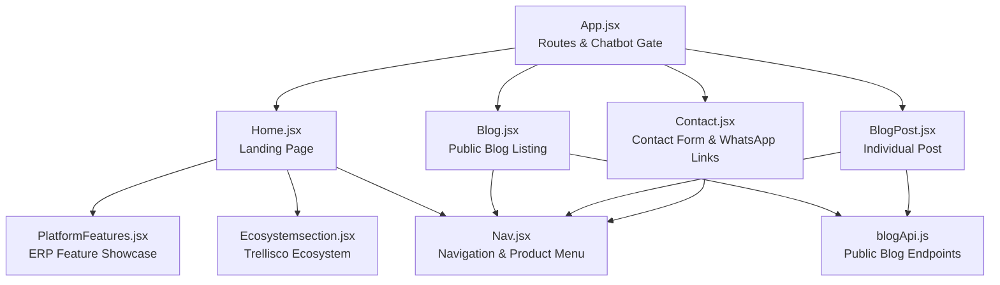
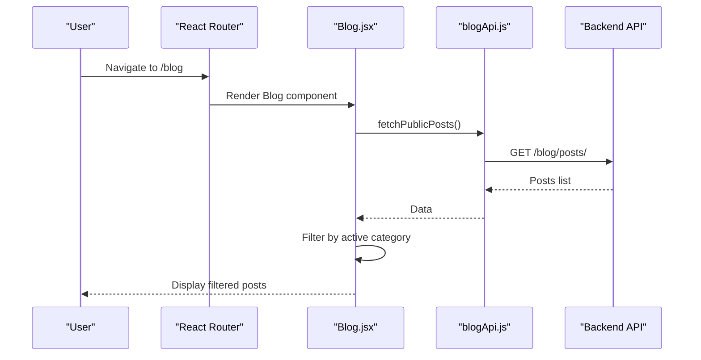
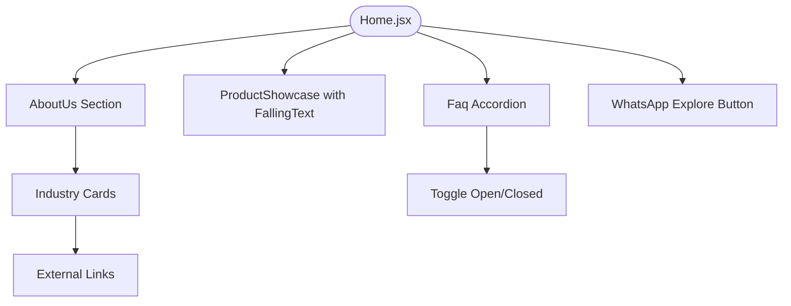
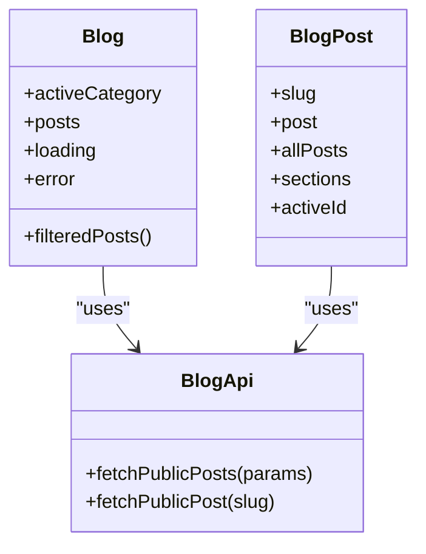
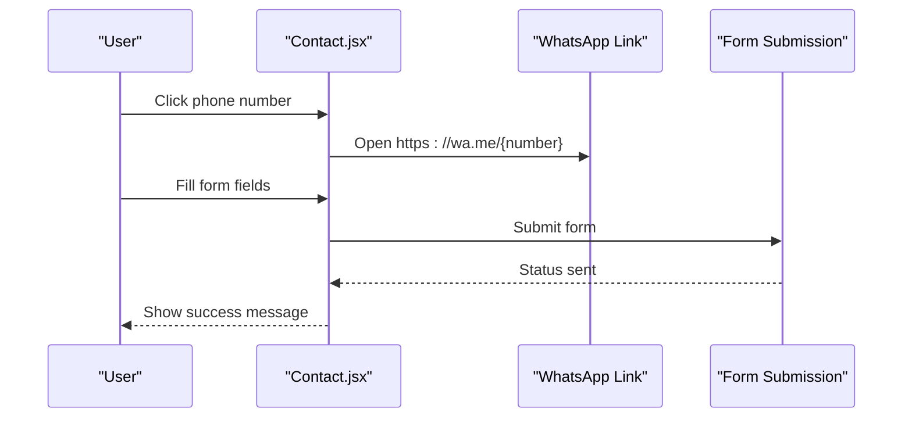
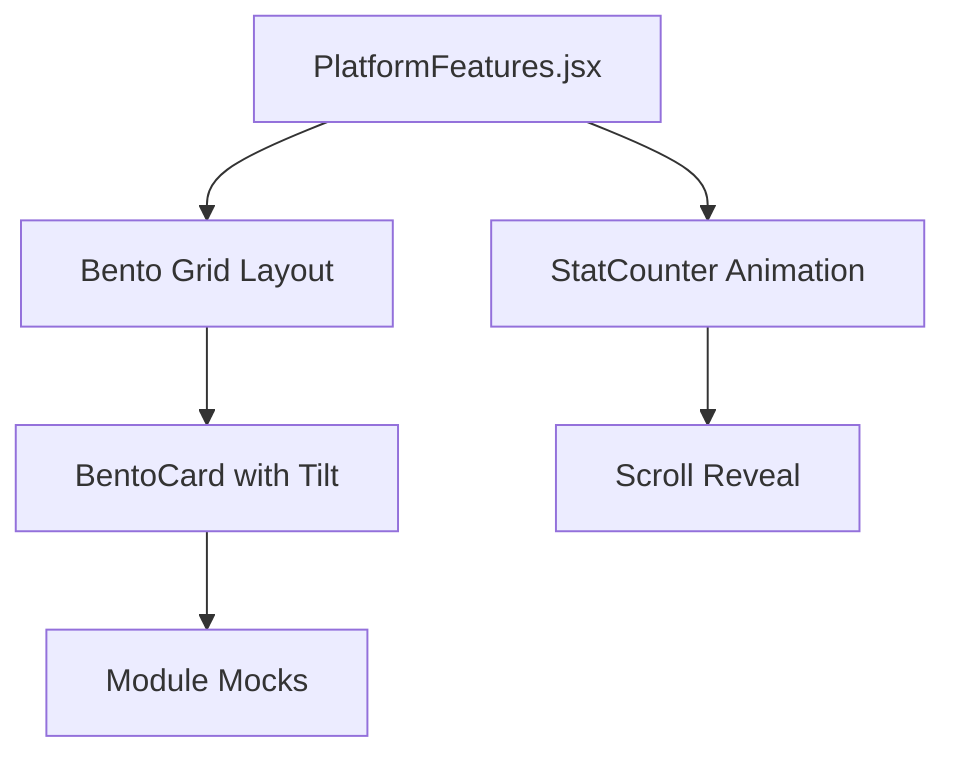
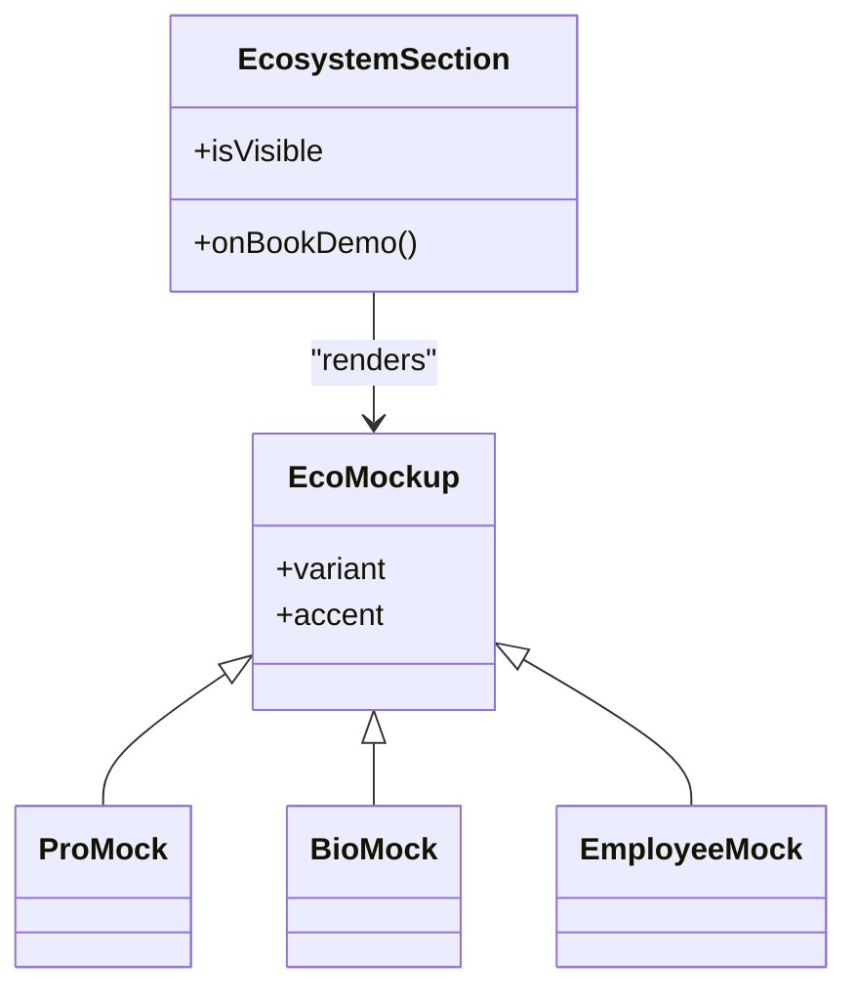
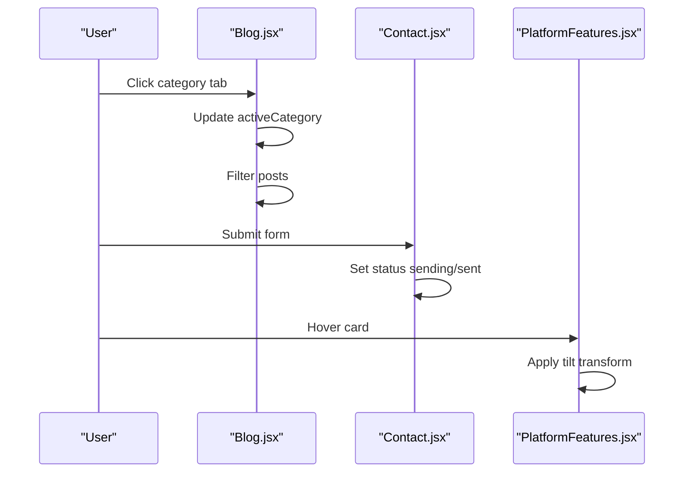
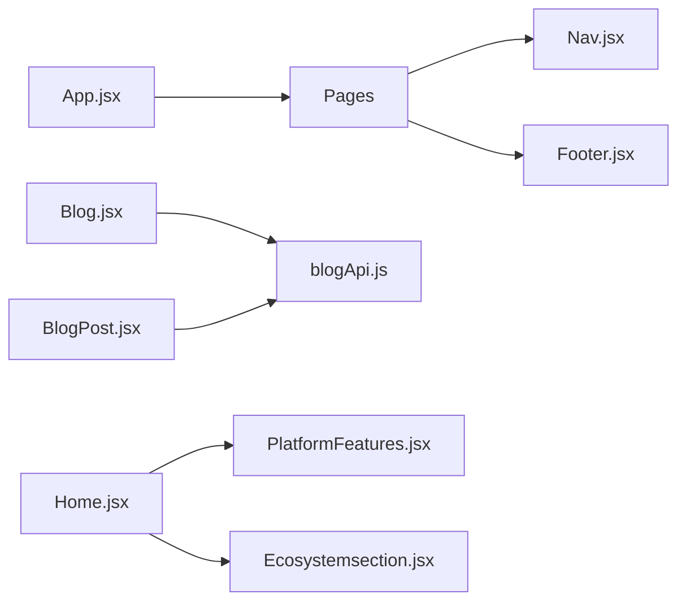

# Public Website Features

<cite>
**Referenced Files in This Document**
- [App.jsx](file://src/App.jsx)
- [Home.jsx](file://src/pages/Home.jsx)
- [Blog.jsx](file://src/pages/Blog.jsx)
- [BlogPost.jsx](file://src/pages/BlogPost.jsx)
- [Contact.jsx](file://src/pages/Contact.jsx)
- [PlatformFeatures.jsx](file://src/pages/PlatformFeatures.jsx)
- [Ecosystemsection.jsx](file://src/pages/Ecosystemsection.jsx)
- [blogApi.js](file://src/api/blogApi.js)
- [Nav.jsx](file://src/components/Nav.jsx)
</cite>

## Table of Contents
1. [Introduction](#introduction)
2. [Project Structure](#project-structure)
3. [Core Components](#core-components)
4. [Architecture Overview](#architecture-overview)
5. [Detailed Component Analysis](#detailed-component-analysis)
6. [Dependency Analysis](#dependency-analysis)
7. [Performance Considerations](#performance-considerations)
8. [Troubleshooting Guide](#troubleshooting-guide)
9. [Conclusion](#conclusion)

## Introduction
This document explains the public-facing website features of TRELLISCO_ERP_FRONTEND. It covers the landing page, blog system, contact integration, platform features showcase, ecosystem section, responsive design patterns, visual effects, performance considerations, user interaction flows, and accessibility compliance. The focus is on how the frontend renders marketing content, exposes ERP solutions, and connects users to support channels such as WhatsApp.

## Project Structure
The public website is a React application using React Router for navigation. Public routes include the home page, blog listing, individual blog post, and contact page. Shared components like navigation and footer are reused across pages. Blog data is fetched from backend endpoints through dedicated API helpers.

**Diagram sources**
- [App.jsx:25-69](file://src/App.jsx#L25-L69)
- [Home.jsx:1-15](file://src/pages/Home.jsx#L1-L15)
- [Blog.jsx:1-8](file://src/pages/Blog.jsx#L1-L8)
- [BlogPost.jsx:1-7](file://src/pages/BlogPost.jsx#L1-L7)
- [Contact.jsx:1-4](file://src/pages/Contact.jsx#L1-L4)
- [PlatformFeatures.jsx:1-15](file://src/pages/PlatformFeatures.jsx#L1-L15)
- [Ecosystemsection.jsx:1-14](file://src/pages/Ecosystemsection.jsx#L1-L14)
- [blogApi.js:1-33](file://src/api/blogApi.js#L1-L33)
- [Nav.jsx:1-19](file://src/components/Nav.jsx#L1-L19)

**Section sources**
- [App.jsx:25-69](file://src/App.jsx#L25-L69)

## Core Components
- Landing page: Hero area, About Us section with industry cards, product showcase with physics-based text animation, FAQ accordion, and calls to action.
- Blog system: Public listing with category tabs, post cards, comparison section, CTA banner; individual post view with block-based body rendering, table of contents, sharing, and related posts.
- Contact page: Office details, phone numbers linked to WhatsApp, email links, and a form with submission state.
- Platform features: Bento grid showcasing HRMS, property management, gym, restaurant, asset management, and e-commerce modules with animated stats and hover tilt.
- Ecosystem section: Cards representing Trellisco Pro, Bio, Employee, Academy, Community, Compliance, Payroll, Insights, Support with mock UIs and mascot interaction.
- Navigation: Mega menu with product groups, previews, and external links.

**Section sources**
- [Home.jsx:103-258](file://src/pages/Home.jsx#L103-L258)
- [Home.jsx:432-479](file://src/pages/Home.jsx#L432-L479)
- [Home.jsx:505-531](file://src/pages/Home.jsx#L505-L531)
- [Blog.jsx:40-77](file://src/pages/Blog.jsx#L40-L77)
- [Blog.jsx:96-141](file://src/pages/Blog.jsx#L96-L141)
- [Blog.jsx:200-237](file://src/pages/Blog.jsx#L200-L237)
- [Blog.jsx:242-261](file://src/pages/Blog.jsx#L242-L261)
- [BlogPost.jsx:90-173](file://src/pages/BlogPost.jsx#L90-L173)
- [BlogPost.jsx:179-194](file://src/pages/BlogPost.jsx#L179-L194)
- [BlogPost.jsx:274-325](file://src/pages/BlogPost.jsx#L274-L325)
- [BlogPost.jsx:377-419](file://src/pages/BlogPost.jsx#L377-L419)
- [Contact.jsx:69-92](file://src/pages/Contact.jsx#L69-L92)
- [Contact.jsx:127-193](file://src/pages/Contact.jsx#L127-L193)
- [Contact.jsx:195-252](file://src/pages/Contact.jsx#L195-L252)
- [PlatformFeatures.jsx:305-380](file://src/pages/PlatformFeatures.jsx#L305-L380)
- [PlatformFeatures.jsx:385-426](file://src/pages/PlatformFeatures.jsx#L385-L426)
- [PlatformFeatures.jsx:431-555](file://src/pages/PlatformFeatures.jsx#L431-L555)
- [Ecosystemsection.jsx:141-205](file://src/pages/Ecosystemsection.jsx#L141-L205)
- [Ecosystemsection.jsx:207-213](file://src/pages/Ecosystemsection.jsx#L207-L213)
- [Ecosystemsection.jsx:242-306](file://src/pages/Ecosystemsection.jsx#L242-L306)
- [Nav.jsx:21-542](file://src/components/Nav.jsx#L21-L542)

## Architecture Overview
The public site uses a route-driven architecture where each page component composes shared layout elements (navigation, footer) and feature-specific sections. Data fetching for the blog is centralized in an API module that separates admin and public endpoints. Visual effects rely on IntersectionObserver for scroll-triggered animations and CSS transitions for hover interactions.

**Diagram sources**
- [App.jsx:28-31](file://src/App.jsx#L28-L31)
- [Blog.jsx:266-317](file://src/pages/Blog.jsx#L266-L317)
- [blogApi.js:25-28](file://src/api/blogApi.js#L25-L28)

## Detailed Component Analysis

### Landing Page Implementation
The landing page includes:
- About Us section with image, copy, checklist items, and industry solution cards linking to external sites.
- Industry showcases: HRMS, Hospitality, Property, Gym with accent colors, icons, and feature chips.
- Product showcase with FallingText physics animation and dashboard preview image.
- FAQ accordion with accessible toggle behavior.
- Calls to action including WhatsApp link.

Key implementation patterns:
- Scroll-triggered visibility via IntersectionObserver.
- Inline SVG icons for accessibility and lightweight assets.
- External links with rel="noopener noreferrer".
- Accessible buttons with aria-expanded for accordion.

**Diagram sources**
- [Home.jsx:103-258](file://src/pages/Home.jsx#L103-L258)
- [Home.jsx:432-479](file://src/pages/Home.jsx#L432-L479)
- [Home.jsx:505-531](file://src/pages/Home.jsx#L505-L531)

**Section sources**
- [Home.jsx:103-258](file://src/pages/Home.jsx#L103-L258)
- [Home.jsx:432-479](file://src/pages/Home.jsx#L432-L479)
- [Home.jsx:505-531](file://src/pages/Home.jsx#L505-L531)

### Blog System Architecture
The blog system provides:
- Category tabs for filtering posts.
- Post cards with cover images, category labels, dates, and read time.
- Comparison section highlighting Trellisco advantages.
- CTA banner encouraging trial or sales chat.
- Individual post view with block-based body rendering, share buttons, table of contents, and related posts.

Data flow:
- Public endpoints fetch published posts only.
- Filtering occurs client-side based on active category.
- Individual post loads both the specific post and all posts for related recommendations.

**Diagram sources**
- [Blog.jsx:266-317](file://src/pages/Blog.jsx#L266-L317)
- [blogApi.js:25-33](file://src/api/blogApi.js#L25-L33)
- [BlogPost.jsx:447-587](file://src/pages/BlogPost.jsx#L447-L587)

**Section sources**
- [Blog.jsx:40-77](file://src/pages/Blog.jsx#L40-L77)
- [Blog.jsx:96-141](file://src/pages/Blog.jsx#L96-L141)
- [Blog.jsx:200-237](file://src/pages/Blog.jsx#L200-L237)
- [Blog.jsx:242-261](file://src/pages/Blog.jsx#L242-L261)
- [Blog.jsx:266-317](file://src/pages/Blog.jsx#L266-L317)
- [BlogPost.jsx:90-173](file://src/pages/BlogPost.jsx#L90-L173)
- [BlogPost.jsx:179-194](file://src/pages/BlogPost.jsx#L179-L194)
- [BlogPost.jsx:274-325](file://src/pages/BlogPost.jsx#L274-L325)
- [BlogPost.jsx:377-419](file://src/pages/BlogPost.jsx#L377-L419)
- [BlogPost.jsx:447-587](file://src/pages/BlogPost.jsx#L447-L587)
- [blogApi.js:25-33](file://src/api/blogApi.js#L25-L33)

### Contact Integration with WhatsApp and Support
The contact page displays:
- Office addresses and branches.
- Phone numbers linked to WhatsApp via wa.me URLs.
- Email and website links.
- A contact form with validation and submission states.

Accessibility and UX:
- Labels and placeholders for inputs.
- Disabled submit button during sending.
- Success message after submission.

**Diagram sources**
- [Contact.jsx:69-92](file://src/pages/Contact.jsx#L69-L92)
- [Contact.jsx:127-193](file://src/pages/Contact.jsx#L127-L193)
- [Contact.jsx:195-252](file://src/pages/Contact.jsx#L195-L252)

**Section sources**
- [Contact.jsx:69-92](file://src/pages/Contact.jsx#L69-L92)
- [Contact.jsx:127-193](file://src/pages/Contact.jsx#L127-L193)
- [Contact.jsx:195-252](file://src/pages/Contact.jsx#L195-L252)

### Platform Features Showcase
The platform features section presents:
- Animated stat counters triggered by scroll.
- Bento grid cards for HRMS, property management, gym, restaurant, asset management, and e-commerce.
- Hover tilt effect and gradient backgrounds.
- Feature tags indicating additional capabilities per module.

Implementation highlights:
- IntersectionObserver for reveal animations.
- Mouse move handlers for 3D tilt.
- Inline styles and dynamic classes for responsiveness.

**Diagram sources**
- [PlatformFeatures.jsx:305-380](file://src/pages/PlatformFeatures.jsx#L305-L380)
- [PlatformFeatures.jsx:385-426](file://src/pages/PlatformFeatures.jsx#L385-L426)
- [PlatformFeatures.jsx:431-555](file://src/pages/PlatformFeatures.jsx#L431-L555)

**Section sources**
- [PlatformFeatures.jsx:305-380](file://src/pages/PlatformFeatures.jsx#L305-L380)
- [PlatformFeatures.jsx:385-426](file://src/pages/PlatformFeatures.jsx#L385-L426)
- [PlatformFeatures.jsx:431-555](file://src/pages/PlatformFeatures.jsx#L431-L555)

### Ecosystem Sections
The ecosystem section highlights:
- Trellisco Pro, Bio, Employee, Academy, Community, Compliance, Payroll, Insights, Support.
- Mock UIs for reporting, chat, and file operations.
- Mascot image with optional demo booking callback.
- 3D tilt-on-hover for cards.

**Diagram sources**
- [Ecosystemsection.jsx:141-205](file://src/pages/Ecosystemsection.jsx#L141-L205)
- [Ecosystemsection.jsx:207-213](file://src/pages/Ecosystemsection.jsx#L207-L213)
- [Ecosystemsection.jsx:242-306](file://src/pages/Ecosystemsection.jsx#L242-L306)

**Section sources**
- [Ecosystemsection.jsx:141-205](file://src/pages/Ecosystemsection.jsx#L141-L205)
- [Ecosystemsection.jsx:207-213](file://src/pages/Ecosystemsection.jsx#L207-L213)
- [Ecosystemsection.jsx:242-306](file://src/pages/Ecosystemsection.jsx#L242-L306)

### Responsive Design Patterns
Common patterns across components:
- CSS media queries for mobile layouts.
- Flexbox and CSS Grid for adaptive structures.
- Clamp-based font sizing for fluid typography.
- IntersectionObserver for progressive reveals.

Examples:
- Platform features grid collapses to single column on small screens.
- Blog cards and comparison tables adapt to viewport width.
- Contact timeline stacks vertically on narrow devices.

**Section sources**
- [PlatformFeatures.jsx:61-64](file://src/pages/PlatformFeatures.jsx#L61-L64)
- [Blog.jsx:122-141](file://src/pages/Blog.jsx#L122-L141)
- [Contact.jsx:127-193](file://src/pages/Contact.jsx#L127-L193)

### Visual Effects Implementation
- Physics-based falling text in product showcase.
- 3D tilt on hover for bento cards and ecosystem cards.
- Gradient backgrounds and soft glows for depth.
- Animated stat counters with easing functions.
- Scroll-triggered opacity and transform transitions.

**Section sources**
- [Home.jsx:505-531](file://src/pages/Home.jsx#L505-L531)
- [PlatformFeatures.jsx:305-380](file://src/pages/PlatformFeatures.jsx#L305-L380)
- [PlatformFeatures.jsx:385-426](file://src/pages/PlatformFeatures.jsx#L385-L426)
- [Ecosystemsection.jsx:215-225](file://src/pages/Ecosystemsection.jsx#L215-L225)

### Performance Considerations
- Lazy loading images with loading="lazy".
- Minimal DOM updates using state and memoization.
- Efficient event handling for mouse moves with bounds checks.
- Avoiding heavy libraries; using native IntersectionObserver and requestAnimationFrame.
- Separating admin and public API calls to prevent unnecessary token usage.

**Section sources**
- [Blog.jsx:82-94](file://src/pages/Blog.jsx#L82-L94)
- [BlogPost.jsx:244-253](file://src/pages/BlogPost.jsx#L244-L253)
- [PlatformFeatures.jsx:320-333](file://src/pages/PlatformFeatures.jsx#L320-L333)
- [PlatformFeatures.jsx:402-416](file://src/pages/PlatformFeatures.jsx#L402-L416)
- [blogApi.js:25-33](file://src/api/blogApi.js#L25-L33)

### User Interaction Flows
- Blog category selection filters posts instantly.
- Contact form submission shows sending state and success feedback.
- Blog post sharing opens social platforms or copies link.
- Platform feature cards tilt on hover and reveal on scroll.
- Ecosystem cards tilt and mascot triggers demo booking.

**Diagram sources**
- [Blog.jsx:266-317](file://src/pages/Blog.jsx#L266-L317)
- [Contact.jsx:195-252](file://src/pages/Contact.jsx#L195-L252)
- [PlatformFeatures.jsx:320-333](file://src/pages/PlatformFeatures.jsx#L320-L333)

### Accessibility Compliance Measures
- Semantic HTML elements (section, nav, h1-h3).
- ARIA attributes for interactive controls (aria-expanded, aria-selected, aria-label).
- Keyboard-accessible buttons and links.
- Alt text for images and descriptive labels for icons.
- Focus management for modals and accordions.

**Section sources**
- [Home.jsx:397-429](file://src/pages/Home.jsx#L397-L429)
- [Blog.jsx:61-74](file://src/pages/Blog.jsx#L61-L74)
- [BlogPost.jsx:138-169](file://src/pages/BlogPost.jsx#L138-L169)
- [Contact.jsx:195-252](file://src/pages/Contact.jsx#L195-L252)

## Dependency Analysis
The public website depends on:
- React Router for navigation.
- Shared components (Nav, Footer) for consistent layout.
- API helpers for blog data retrieval.
- Assets (images, logos) for branding and visuals.

**Diagram sources**
- [App.jsx:25-69](file://src/App.jsx#L25-L69)
- [Blog.jsx:1-8](file://src/pages/Blog.jsx#L1-L8)
- [BlogPost.jsx:1-7](file://src/pages/BlogPost.jsx#L1-L7)
- [Home.jsx:1-15](file://src/pages/Home.jsx#L1-L15)

**Section sources**
- [App.jsx:25-69](file://src/App.jsx#L25-L69)
- [blogApi.js:1-33](file://src/api/blogApi.js#L1-L33)

## Performance Considerations
- Use lazy loading for images and videos to reduce initial bundle size.
- Debounce or throttle expensive mouse move handlers if needed.
- Prefer CSS transforms over layout-affecting properties for animations.
- Keep IntersectionObserver thresholds low to avoid excessive re-renders.
- Separate admin and public API calls to minimize overhead.

[No sources needed since this section provides general guidance]

## Troubleshooting Guide
Common issues and resolutions:
- Blog posts not loading: Check network requests to /blog/posts/ and ensure public endpoint is reachable.
- Cover images missing: Verify coverImage field in backend response and correct URL resolution.
- WhatsApp links not opening: Confirm phone number format without spaces or dashes in wa.me URL.
- Form submission not working: Replace placeholder setTimeout with actual API call and handle errors.
- Animations not triggering: Ensure IntersectionObserver is supported and elements are visible within viewport.

**Section sources**
- [Blog.jsx:272-293](file://src/pages/Blog.jsx#L272-L293)
- [BlogPost.jsx:455-487](file://src/pages/BlogPost.jsx#L455-L487)
- [Contact.jsx:103-111](file://src/pages/Contact.jsx#L103-L111)

## Conclusion
The public-facing website of TRELLISCO_ERP_FRONTEND delivers a polished, interactive experience for visitors exploring ERP solutions. It combines a compelling landing page, robust blog system, accessible contact integration, and visually rich feature showcases. The architecture emphasizes performance, accessibility, and clear user flows while maintaining extensibility for future enhancements.

[No sources needed since this section summarizes without analyzing specific files]