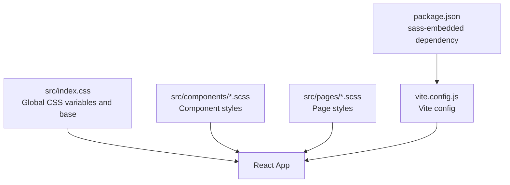
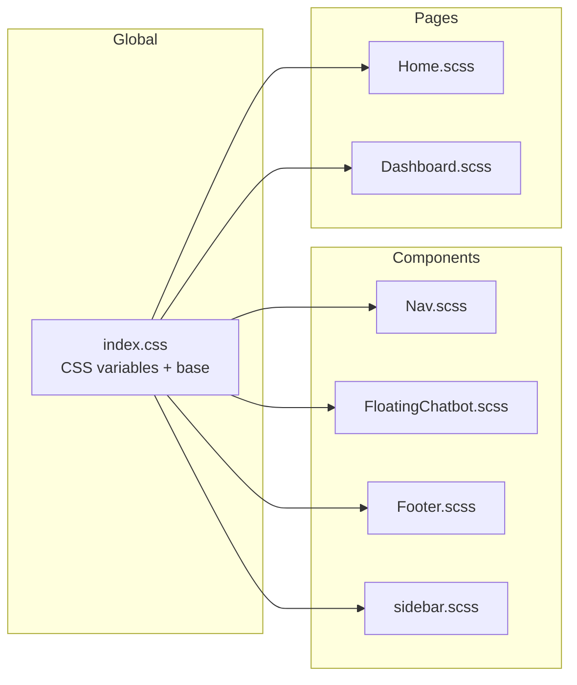
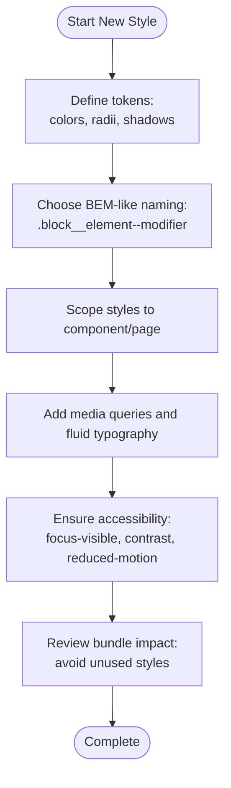
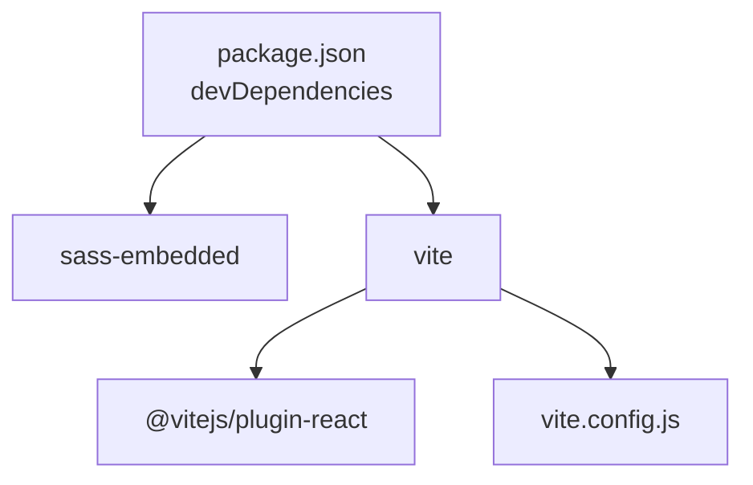

# Styling and Design System

<cite>
**Referenced Files in This Document**
- [index.css](file://src/index.css)
- [App.css](file://src/App.css)
- [vite.config.js](file://vite.config.js)
- [package.json](file://package.json)
- [Nav.scss](file://src/components/Nav.scss)
- [FloatingChatbot.scss](file://src/components/FloatingChatbot.scss)
- [Footer.scss](file://src/components/Footer.scss)
- [sidebar.scss](file://src/components/sidebar.scss)
- [Home.scss](file://src/pages/Home.scss)
- [Dashboard.scss](file://src/pages/AdminDashboard/Dashboard.scss)
</cite>

## Table of Contents
1. [Introduction](#introduction)
2. [Project Structure](#project-structure)
3. [Core Components](#core-components)
4. [Architecture Overview](#architecture-overview)
5. [Detailed Component Analysis](#detailed-component-analysis)
6. [Dependency Analysis](#dependency-analysis)
7. [Performance Considerations](#performance-considerations)
8. [Troubleshooting Guide](#troubleshooting-guide)
9. [Conclusion](#conclusion)
10. [Appendices](#appendices)

## Introduction
This document explains the styling and design system used across the application. It covers how SCSS is organized, where global styles live, how responsive behavior is implemented, and what patterns are used for component scoping and naming. It also documents CSS custom properties, theme tokens, accessibility considerations, cross-browser compatibility notes, and performance guidance for animations and transitions. Finally, it provides practical guidelines for extending the design system consistently and keeping the CSS bundle small.

## Project Structure
The styling approach combines:
- Global CSS variables and base resets in a single entry stylesheet.
- Per-component SCSS files colocated with their React components.
- Page-level SCSS files colocated with page components.
- Vite as the build tool with Sass support via sass-embedded.

**Diagram sources**
- [index.css:1-43](file://src/index.css#L1-L43)
- [vite.config.js:1-24](file://vite.config.js#L1-L24)
- [package.json:20-31](file://package.json#L20-L31)

**Section sources**
- [index.css:1-43](file://src/index.css#L1-L43)
- [package.json:20-31](file://package.json#L20-L31)
- [vite.config.js:1-24](file://vite.config.js#L1-L24)

## Core Components
The design system is built around these core areas:

- Global tokens and base styles
  - CSS custom properties define colors, typography, shadows, and color scheme.
  - Base reset sets box-sizing and root layout.
- Component-scoped SCSS using BEM-like naming
  - Block names use lowercase words; modifiers use double hyphens; elements use double underscores.
  - Mixins and local SCSS variables encapsulate shared behaviors and tokens within components.
- Responsive design
  - Media queries adjust layouts at consistent breakpoints.
  - Fluid typography uses clamp() for scalable text.
- Animations and transitions
  - Lightweight transforms and opacity changes.
  - Respects prefers-reduced-motion where applicable.

Key implementation references:
- Global tokens and base: [index.css:1-43](file://src/index.css#L1-L43)
- Component examples:
  - Navigation: [Nav.scss:1-313](file://src/components/Nav.scss#L1-L313)
  - Floating chatbot: [FloatingChatbot.scss:1-306](file://src/components/FloatingChatbot.scss#L1-L306)
  - Footer: [Footer.scss:1-390](file://src/components/Footer.scss#L1-L390)
  - Sidebar: [sidebar.scss:1-293](file://src/components/sidebar.scss#L1-L293)
- Page examples:
  - Home hero and sections: [Home.scss:1-800](file://src/pages/Home.scss#L1-L800)
  - Admin dashboard shell and cards: [Dashboard.scss:1-366](file://src/pages/AdminDashboard/Dashboard.scss#L1-L366)

**Section sources**
- [index.css:1-43](file://src/index.css#L1-L43)
- [Nav.scss:1-313](file://src/components/Nav.scss#L1-L313)
- [FloatingChatbot.scss:1-306](file://src/components/FloatingChatbot.scss#L1-L306)
- [Footer.scss:1-390](file://src/components/Footer.scss#L1-L390)
- [sidebar.scss:1-293](file://src/components/sidebar.scss#L1-L293)
- [Home.scss:1-800](file://src/pages/Home.scss#L1-L800)
- [Dashboard.scss:1-366](file://src/pages/AdminDashboard/Dashboard.scss#L1-L366)

## Architecture Overview
The styling architecture follows a layered model:

- Layer 1: Global tokens and base (index.css)
- Layer 2: Shared component styles (components/*.scss)
- Layer 3: Page-specific styles (pages/*.scss)
- Build pipeline: Vite compiles SCSS to CSS and bundles it into the app.

**Diagram sources**
- [index.css:1-43](file://src/index.css#L1-L43)
- [Nav.scss:1-313](file://src/components/Nav.scss#L1-L313)
- [FloatingChatbot.scss:1-306](file://src/components/FloatingChatbot.scss#L1-L306)
- [Footer.scss:1-390](file://src/components/Footer.scss#L1-L390)
- [sidebar.scss:1-293](file://src/components/sidebar.scss#L1-L293)
- [Home.scss:1-800](file://src/pages/Home.scss#L1-L800)
- [Dashboard.scss:1-366](file://src/pages/AdminDashboard/Dashboard.scss#L1-L366)

## Detailed Component Analysis

### Global Tokens and Base Styles
- CSS custom properties define:
  - Colors for text, background, borders, accents, and social backgrounds.
  - Typography families for sans, headings, and monospace.
  - Shadows and font rendering settings.
- Base rules set:
  - Box-sizing globally.
  - Body margin reset.
  - Root container height using modern viewport units.

Accessibility and cross-browser:
- Uses color-scheme for light mode defaults.
- Applies antialiasing and font-smoothing for better text rendering.

Responsive baseline:
- Adjusts base font size on smaller screens.

**Section sources**
- [index.css:1-43](file://src/index.css#L1-L43)

### Navigation Component (Nav.scss)
Patterns:
- BEM-like structure with block .nav and nested elements like __banner, __bar, __link, __contact.
- Local SCSS variables for colors and fonts.
- Mixins for reusable button and focus-ring styles.
- Focus-visible outlines for keyboard navigation.
- Hover and active states with subtle color and background changes.
- Mobile drawer and hamburger menu hidden by default and shown via media queries.
- Mega menu with columns, groups, and product lists.

Responsive behavior:
- Grid-based bar layout.
- Drawer and mobile list styles activated under specific breakpoints.

Animations:
- Marquee animation for announcement banner.
- Smooth hover transitions for links and buttons.

Accessibility:
- Focus rings applied via mixin.
- Links and buttons maintain readable contrast and clear hover states.

**Section sources**
- [Nav.scss:1-313](file://src/components/Nav.scss#L1-L313)

### Floating Chatbot Component (FloatingChatbot.scss)
Patterns:
- Scoped block .floating-chatbot with elements like __toggle, __panel, __header, __body, __bubble, __input.
- Variants for bot/user bubbles and quick action buttons.
- Scrollable body with hidden scrollbars across browsers.

Animations:
- Floating toggle animation.
- Panel entrance animation.
- Typing indicator dots with staggered delays.

Cross-browser:
- Hides scrollbars using vendor-prefixed and standard properties.

Accessibility:
- Buttons have cursor pointer and transition feedback.
- Clear visual hierarchy between user and bot messages.

**Section sources**
- [FloatingChatbot.scss:1-306](file://src/components/FloatingChatbot.scss#L1-L306)

### Footer Component (Footer.scss)
Patterns:
- BEM-like structure with sections like __top, __address, __cta, __bottom.
- Local SCSS variables for brand colors and typography.
- Grid-based column layout for link groups.
- Social icons with accessible aria-labels and hover effects.

Responsive behavior:
- Columns collapse to two or one column on smaller screens.
- Address section adapts grid and spacing.

Accessibility:
- Links and social icons provide clear hover and focus states.

**Section sources**
- [Footer.scss:1-390](file://src/components/Footer.scss#L1-L390)

### Sidebar Component (sidebar.scss)
Patterns:
- Sticky sidebar with gradient background and internal navigation items.
- Active state highlighting and danger variants for destructive actions.
- Top-level modal overlay styles for logout confirmation.

Responsive behavior:
- Collapses to full-width top bar on smaller screens.

Accessibility:
- Clear hover and focus interactions.
- Modal overlay positioned above content with backdrop blur.

**Section sources**
- [sidebar.scss:1-293](file://src/components/sidebar.scss#L1-L293)

### Home Page (Home.scss)
Patterns:
- Hero banner with floating icons and animated stage.
- Sectioned layout with reveal-on-scroll classes.
- Button variants primary and ghost.
- Local SCSS variables for gradients, colors, radii, and breakpoints.

Responsive behavior:
- Prevents horizontal overflow on phones.
- Adjusts hero visuals and typography for mobile.
- Disables complex animations when reduced motion is preferred.

Accessibility:
- Respects prefers-reduced-motion to disable animations.

**Section sources**
- [Home.scss:1-800](file://src/pages/Home.scss#L1-L800)

### Admin Dashboard (Dashboard.scss)
Patterns:
- Shell layout with sticky sidebar and main content area.
- Card-based stat widgets and panels.
- Consistent radius, shadow, and color tokens.
- Error and empty states styled distinctly.

Responsive behavior:
- Switches from side-by-side to stacked layout on smaller screens.
- Disables transitions when reduced motion is preferred.

Accessibility:
- Clear focus and hover states for interactive elements.

**Section sources**
- [Dashboard.scss:1-366](file://src/pages/AdminDashboard/Dashboard.scss#L1-L366)

### Conceptual Overview
The design system emphasizes:
- Modular SCSS per component/page.
- BEM-like naming for clarity and scoping.
- CSS custom properties for global theming.
- Local SCSS variables for component-specific tokens.
- Responsive design through media queries and fluid typography.
- Accessibility via focus-visible, semantic markup, and reduced-motion support.

[No sources needed since this diagram shows conceptual workflow, not actual code structure]

## Dependency Analysis
Build-time dependencies relevant to styling:
- Vite compiles SCSS to CSS.
- sass-embedded provides the Sass compiler.
- The React plugin integrates JSX/TSX with Vite.

**Diagram sources**
- [package.json:20-31](file://package.json#L20-L31)
- [vite.config.js:1-24](file://vite.config.js#L1-L24)

**Section sources**
- [package.json:20-31](file://package.json#L20-L31)
- [vite.config.js:1-24](file://vite.config.js#L1-L24)

## Performance Considerations
- Prefer transform and opacity for animations to leverage GPU acceleration.
- Use will-change sparingly for elements that animate frequently.
- Avoid heavy filters and large drop-shadows on animated elements.
- Respect prefers-reduced-motion to improve UX for sensitive users.
- Keep SCSS modular to avoid bloating global stylesheets.
- Minimize deep nesting and overly broad selectors to reduce specificity and improve maintainability.

Examples in codebase:
- Transform-based hover and active states across components.
- Reduced-motion handling in Home and Dashboard styles.

**Section sources**
- [Home.scss:393-398](file://src/pages/Home.scss#L393-L398)
- [Dashboard.scss:362-366](file://src/pages/AdminDashboard/Dashboard.scss#L362-L366)

## Troubleshooting Guide
Common issues and resolutions:
- Horizontal overflow on mobile
  - Symptom: Fixed-position elements pushed off-screen.
  - Resolution: Clip overflow on html/body for mobile viewports.
  - Reference: [Home.scss:33-47](file://src/pages/Home.scss#L33-L47)
- Scrollbar visibility inconsistencies
  - Symptom: Scrollbar appears differently across browsers.
  - Resolution: Hide scrollbar using vendor-prefixed and standard properties.
  - Reference: [FloatingChatbot.scss:148-153](file://src/components/FloatingChatbot.scss#L148-L153)
- Focus visibility missing
  - Symptom: Keyboard users cannot see focus.
  - Resolution: Apply focus-visible outlines via mixins or explicit styles.
  - Reference: [Nav.scss:20-25](file://src/components/Nav.scss#L20-L25)
- Animation jank
  - Symptom: Stuttering during scroll-driven animations.
  - Resolution: Use will-change on animated elements; avoid expensive filters on large animated SVGs.
  - Reference: [Home.scss:364-366](file://src/pages/Home.scss#L364-L366)

**Section sources**
- [Home.scss:33-47](file://src/pages/Home.scss#L33-L47)
- [FloatingChatbot.scss:148-153](file://src/components/FloatingChatbot.scss#L148-L153)
- [Nav.scss:20-25](file://src/components/Nav.scss#L20-L25)
- [Home.scss:364-366](file://src/pages/Home.scss#L364-L366)

## Conclusion
The styling system is modular, component-focused, and accessible. It leverages CSS custom properties for global theming, SCSS variables and mixins for local consistency, and BEM-like naming for clarity. Responsive design is achieved through media queries and fluid typography, while animations remain lightweight and respectful of user preferences. Following the provided guidelines will help maintain consistency, improve performance, and keep the CSS bundle lean.

## Appendices

### Guidelines for Adding New Styles
- Create a new SCSS file colocated with the component or page.
- Use BEM-like naming:
  - Block: lowercase words (e.g., .card)
  - Element: double underscore (e.g., .card__title)
  - Modifier: double hyphen (e.g., .card--primary)
- Define local SCSS variables for colors, radii, and shadows within the component.
- Reuse global CSS custom properties for shared tokens when appropriate.
- Add responsive rules inside media queries rather than duplicating styles.
- Include focus-visible outlines for interactive elements.
- Respect prefers-reduced-motion for any animations.

### Theme Customization Options
- Extend or override CSS custom properties in index.css to change global colors, typography, and shadows.
- For component-specific themes, introduce local SCSS variables and update the component’s token definitions.
- Maintain contrast ratios for accessibility when introducing new colors.

### Cross-Browser Compatibility Notes
- Use vendor prefixes where necessary (e.g., mask-image, scrollbar hiding).
- Test focus-visible behavior across browsers.
- Validate transform and opacity animations for smoothness.

### Optimizing CSS Bundle Size
- Keep styles scoped to components/pages.
- Avoid global overrides that duplicate functionality.
- Remove unused styles and consolidate similar selectors.
- Leverage Vite’s build process to tree-shake unused CSS.