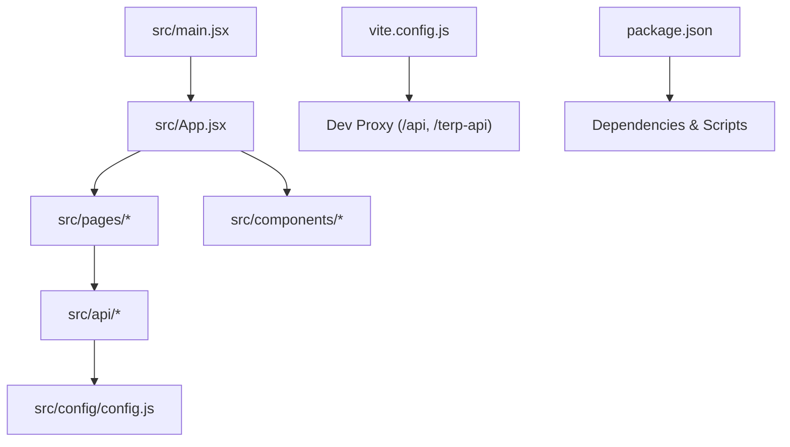
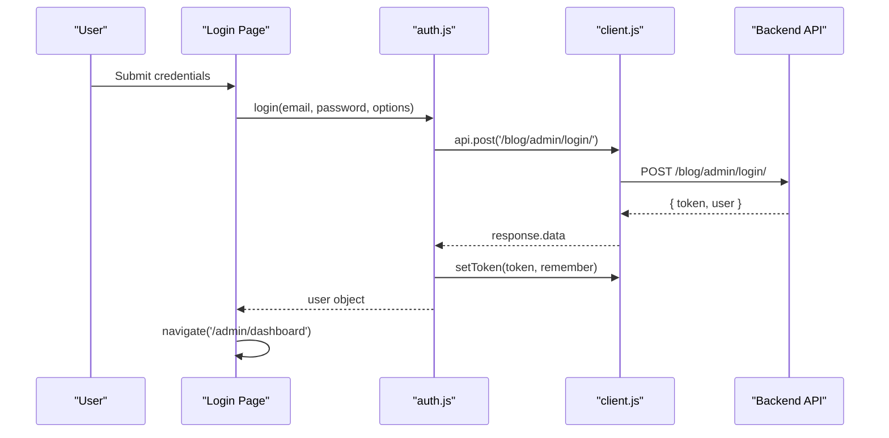
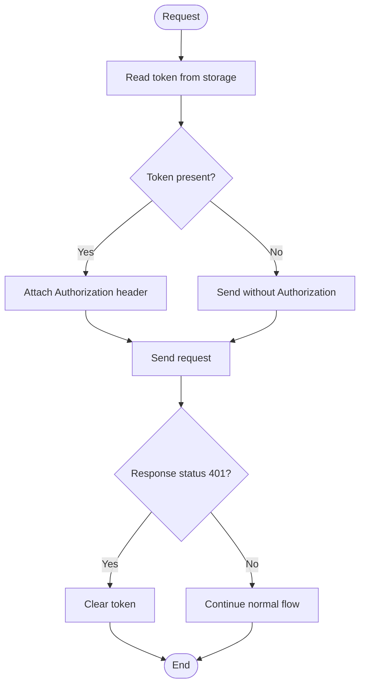
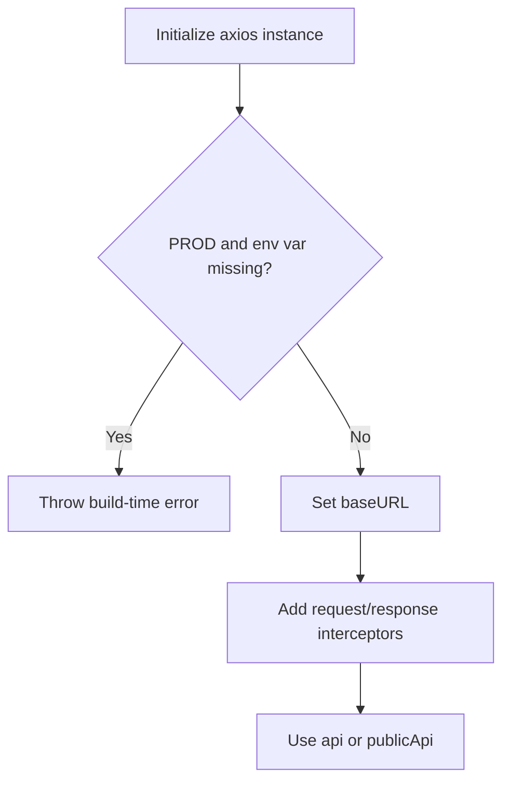
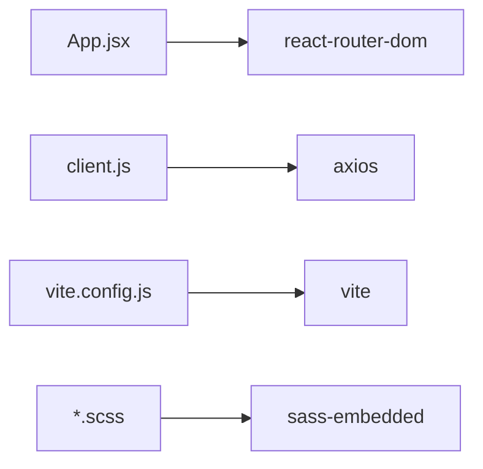

# Troubleshooting and FAQ

<cite>
**Referenced Files in This Document**
- [README.md](file://README.md)
- [package.json](file://package.json)
- [vite.config.js](file://vite.config.js)
- [src/config/config.js](file://src/config/config.js)
- [src/api/client.js](file://src/api/client.js)
- [src/api/auth.js](file://src/api/auth.js)
- [src/api/api.js](file://src/api/api.js)
- [src/App.jsx](file://src/App.jsx)
- [src/main.jsx](file://src/main.jsx)
- [src/pages/AdminDashboard/Login.jsx](file://src/pages/AdminDashboard/Login.jsx)
- [src/pages/AdminDashboard/Dashboard.jsx](file://src/pages/AdminDashboard/Dashboard.jsx)
- [src/pages/Blog.jsx](file://src/pages/Blog.jsx)
- [src/components/FloatingChatbot.jsx](file://src/components/FloatingChatbot.jsx)
</cite>

## Table of Contents
1. [Introduction](#introduction)
2. [Project Structure](#project-structure)
3. [Core Components](#core-components)
4. [Architecture Overview](#architecture-overview)
5. [Detailed Component Analysis](#detailed-component-analysis)
6. [Dependency Analysis](#dependency-analysis)
7. [Performance Considerations](#performance-considerations)
8. [Troubleshooting Guide](#troubleshooting-guide)
9. [Conclusion](#conclusion)
10. [Appendices](#appendices)

## Introduction
This document provides a comprehensive troubleshooting guide and FAQ for the project. It focuses on authentication issues (token expiration, CORS, session management), API integration problems (network errors, response parsing, error handling), React debugging techniques, performance profiling, build/deployment pitfalls, dependency conflicts, environment configuration, and diagnostic workflows. The guidance is grounded in the actual codebase to ensure accuracy and actionability.

## Project Structure
The application is a React + Vite project with:
- Public pages under src/pages
- Admin dashboard under src/pages/AdminDashboard
- Shared API clients under src/api
- Global app shell and routing in src/App.jsx
- Environment-driven base URLs via src/config/config.js
- Development proxy configuration in vite.config.js

**Diagram sources**
- [src/main.jsx:1-11](file://src/main.jsx#L1-L11)
- [src/App.jsx:1-74](file://src/App.jsx#L1-L74)
- [src/config/config.js:1-3](file://src/config/config.js#L1-L3)
- [vite.config.js:1-24](file://vite.config.js#L1-L24)
- [package.json:1-33](file://package.json#L1-L33)

**Section sources**
- [README.md:1-17](file://README.md#L1-L17)
- [package.json:1-33](file://package.json#L1-L33)
- [vite.config.js:1-24](file://vite.config.js#L1-L24)
- [src/config/config.js:1-3](file://src/config/config.js#L1-L3)

## Core Components
- Authentication client: token storage, request/response interceptors, admin vs public APIs
- Auth flows: login/logout, user persistence, route protection
- API layer: Axios instances, base URL resolution, interceptor behavior
- Routing and guards: RequireAuth, chatbot visibility gating
- Pages: Login form, Dashboard data loading, Blog public feed

Key responsibilities:
- Token lifecycle and scheme handling
- Centralized error handling for network and auth failures
- Environment-based base URL configuration
- Dev-time proxying to backend services

**Section sources**
- [src/api/client.js:1-88](file://src/api/client.js#L1-L88)
- [src/api/auth.js:1-40](file://src/api/auth.js#L1-L40)
- [src/App.jsx:1-74](file://src/App.jsx#L1-L74)
- [src/pages/AdminDashboard/Login.jsx:1-244](file://src/pages/AdminDashboard/Login.jsx#L1-L244)
- [src/pages/AdminDashboard/Dashboard.jsx:1-234](file://src/pages/AdminDashboard/Dashboard.jsx#L1-L234)
- [src/pages/Blog.jsx:1-320](file://src/pages/Blog.jsx#L1-L320)

## Architecture Overview
The runtime flow centers around Axios interceptors that attach tokens and handle 401 responses, while routes protect admin areas based on token presence.

**Diagram sources**
- [src/pages/AdminDashboard/Login.jsx:113-136](file://src/pages/AdminDashboard/Login.jsx#L113-L136)
- [src/api/auth.js:4-19](file://src/api/auth.js#L4-L19)
- [src/api/client.js:47-75](file://src/api/client.js#L47-L75)

## Detailed Component Analysis

### Authentication and Session Management
- Token storage:
  - Admin API uses a dedicated key stored in localStorage or sessionStorage depending on the “remember” option.
  - Public API uses a separate instance without admin token injection.
- Request headers:
  - Admin requests attach Authorization header using the correct scheme expected by the backend.
- Response handling:
  - On 401, the token is cleared automatically to force re-authentication.
- Route protection:
  - Admin routes are guarded by a RequireAuth wrapper that checks token presence.

Common issues and fixes:
- Token not sent:
  - Ensure the token was persisted via setToken during login and that the same storage location is used when reading it.
- Wrong Authorization scheme:
  - Use the backend’s expected scheme; do not mix schemes between different API clients.
- Unexpected logout:
  - A 401 clears the token; verify backend returns 401 only for invalid/expired tokens.
- Mixed sessions:
  - Remember me toggles between localStorage and sessionStorage; confirm the intended persistence scope.

**Diagram sources**
- [src/api/client.js:21-42](file://src/api/client.js#L21-L42)
- [src/api/client.js:54-75](file://src/api/client.js#L54-L75)

**Section sources**
- [src/api/client.js:1-88](file://src/api/client.js#L1-L88)
- [src/api/auth.js:1-40](file://src/api/auth.js#L1-L40)
- [src/App.jsx:15-17](file://src/App.jsx#L15-L17)

### API Integration and Error Handling
- Base URL resolution:
  - Uses an environment variable at build time; missing value in production throws an explicit error.
- Interceptors:
  - Admin instance attaches token and clears on 401.
  - Public instance remains unauthenticated to show visitor-facing content even when an admin is logged in.
- Error handling patterns:
  - Components catch errors and surface backend messages where available.
  - Network errors fall back to generic messages.

Common issues and fixes:
- Missing base URL in production:
  - Configure the environment variable before building; the code will fail fast if omitted.
- CORS errors:
  - In development, use the dev server proxy for same-origin requests.
  - For cross-origin calls, ensure the backend allows the frontend origin and methods.
- Response parsing:
  - Some endpoints return nested payloads; components normalize arrays or paginated results.

**Diagram sources**
- [src/api/client.js:4-19](file://src/api/client.js#L4-L19)
- [src/api/client.js:47-88](file://src/api/client.js#L47-L88)

**Section sources**
- [src/api/client.js:1-88](file://src/api/client.js#L1-L88)
- [src/pages/AdminDashboard/Dashboard.jsx:107-134](file://src/pages/AdminDashboard/Dashboard.jsx#L107-L134)
- [src/pages/Blog.jsx:272-293](file://src/pages/Blog.jsx#L272-L293)

### Build and Deployment Configuration
- Vite dev server proxies:
  - /api -> local backend
  - /terp-api -> external service with rewrite and secure flag
- Environment variables:
  - API base URL is injected at build time; must be set for production builds.
- Scripts:
  - Standard scripts for dev, build, lint, preview.

Common issues and fixes:
- Localhost calls in production:
  - Ensure the environment variable is set; otherwise, the build fails early.
- Proxy misconfiguration:
  - Verify target host/port and rewrite rules match your backend.
- Preview mismatches:
  - Use the preview script to validate production-like behavior locally.

**Section sources**
- [vite.config.js:1-24](file://vite.config.js#L1-L24)
- [src/config/config.js:1-3](file://src/config/config.js#L1-L3)
- [package.json:6-10](file://package.json#L6-L10)

### React Component Debugging
- Login page:
  - Validates inputs, shows backend-provided error details, manages submitting state.
- Dashboard:
  - Loads posts and announcements concurrently, handles partial failures gracefully, displays errors.
- Blog page:
  - Fetches public posts, normalizes array or paginated result, filters by category.
- Floating chatbot:
  - Manages message history, typing indicator, quick questions, and IntersectionObserver for visibility.

Debugging tips:
- Inspect component state and props using React DevTools.
- Validate async flows with try/catch blocks and log backend error bodies.
- Use cancellation flags to prevent state updates after unmount.

**Section sources**
- [src/pages/AdminDashboard/Login.jsx:108-136](file://src/pages/AdminDashboard/Login.jsx#L108-L136)
- [src/pages/AdminDashboard/Dashboard.jsx:107-134](file://src/pages/AdminDashboard/Dashboard.jsx#L107-L134)
- [src/pages/Blog.jsx:272-293](file://src/pages/Blog.jsx#L272-L293)
- [src/components/FloatingChatbot.jsx:200-218](file://src/components/FloatingChatbot.jsx#L200-L218)

## Dependency Analysis
External dependencies relevant to troubleshooting:
- axios: HTTP client with interceptors
- react-router-dom: routing and navigation
- vite: dev server and build tooling
- sass-embedded: SCSS compilation

Potential conflicts:
- Mismatched React versions across packages
- Axios version incompatibilities with interceptors
- Vite plugin versions affecting HMR and builds

Resolution strategies:
- Align peer dependencies with the installed versions.
- Pin versions in package.json and run lockfile audits.
- Rebuild after updating dependencies to avoid stale caches.

**Diagram sources**
- [package.json:12-30](file://package.json#L12-L30)
- [src/App.jsx:1-11](file://src/App.jsx#L1-L11)
- [src/api/client.js:1-2](file://src/api/client.js#L1-L2)
- [vite.config.js:1-2](file://vite.config.js#L1-L2)

**Section sources**
- [package.json:1-33](file://package.json#L1-L33)

## Performance Considerations
- Minimize re-renders:
  - Memoize derived data (e.g., stats, recent posts).
  - Avoid unnecessary state updates inside effects.
- Efficient data fetching:
  - Use parallel requests where possible.
  - Normalize responses to reduce conditional logic.
- Memory hygiene:
  - Clean up observers and timers in effect cleanup functions.
  - Cancel pending operations on unmount.

Recommendations:
- Profile with React Profiler to identify expensive renders.
- Monitor memory usage in browser DevTools over long sessions.
- Debounce heavy computations and limit list sizes.

[No sources needed since this section provides general guidance]

## Troubleshooting Guide

### Authentication Problems

- Token expiration
  - Symptom: Requests start failing with 401; user is unexpectedly redirected.
  - Cause: Backend rejects expired tokens; interceptor clears token on 401.
  - Fix: Prompt re-login; ensure token refresh strategy aligns with backend expectations.

- CORS errors
  - Symptom: Browser blocks requests to backend.
  - Causes: Cross-origin requests without proper CORS headers; wrong origin/methods allowed.
  - Fixes:
    - Development: Use Vite proxy for same-origin requests.
    - Production: Configure backend CORS to allow the frontend origin.

- Session management issues
  - Symptom: “Remember me” does not persist or persists incorrectly.
  - Causes: Mixing localStorage and sessionStorage; inconsistent token keys.
  - Fixes:
    - Confirm the remember flag maps to the intended storage.
    - Ensure all code paths read/write the same token key.

**Section sources**
- [src/api/client.js:21-42](file://src/api/client.js#L21-L42)
- [src/api/client.js:54-75](file://src/api/client.js#L54-L75)
- [src/api/auth.js:4-19](file://src/api/auth.js#L4-L19)
- [vite.config.js:7-21](file://vite.config.js#L7-L21)

### API Integration Problems

- Network errors
  - Symptom: Requests fail due to DNS, timeout, or unreachable backend.
  - Checks:
    - Verify base URL and proxy settings.
    - Confirm backend is running and reachable.
  - Fixes:
    - Update VITE_API_BASE_URL or fix proxy targets.
    - Add retries/backoff for transient failures.

- Response parsing issues
  - Symptom: Data not displayed or lists empty.
  - Causes: Backend returns nested objects or paginated structures.
  - Fixes:
    - Normalize responses to arrays in components.
    - Handle both direct arrays and .results fields.

- Error handling strategies
  - Best practices:
    - Surface backend detail messages when available.
    - Provide user-friendly fallback messages.
    - Log errors for diagnostics without exposing sensitive data.

**Section sources**
- [src/api/client.js:4-19](file://src/api/client.js#L4-L19)
- [src/pages/AdminDashboard/Dashboard.jsx:113-127](file://src/pages/AdminDashboard/Dashboard.jsx#L113-L127)
- [src/pages/Blog.jsx:278-286](file://src/pages/Blog.jsx#L278-L286)

### React Component Debugging

- State and side effects
  - Use strict mode to detect side effects.
  - Ensure cleanup functions remove observers and cancel pending work.

- Rendering issues
  - Identify unnecessary re-renders with React DevTools profiler.
  - Stabilize keys and avoid inline object creation in loops.

- Chatbot visibility
  - IntersectionObserver hides launcher when hero banner is visible.
  - Ensure the observed element exists; otherwise, default to visible.

**Section sources**
- [src/components/FloatingChatbot.jsx:200-218](file://src/components/FloatingChatbot.jsx#L200-L218)
- [src/main.jsx:6-10](file://src/main.jsx#L6-L10)

### Build and Deployment Issues

- Missing environment variables
  - Symptom: Build fails with explicit error about missing base URL.
  - Fix: Set VITE_API_BASE_URL in .env.production and rebuild.

- Proxy misconfiguration
  - Symptom: Local development cannot reach backend.
  - Fix: Correct target host/port and rewrite rules in Vite config.

- Dependency conflicts
  - Symptom: HMR breaks or runtime errors after upgrades.
  - Fix: Align versions, reinstall dependencies, and clear caches.

**Section sources**
- [src/api/client.js:10-16](file://src/api/client.js#L10-L16)
- [vite.config.js:7-21](file://vite.config.js#L7-L21)
- [package.json:6-30](file://package.json#L6-L30)

### Diagnostic Tools and Techniques

- Browser DevTools
  - Network tab: inspect requests, headers, and responses.
  - Application tab: inspect localStorage/sessionStorage tokens.
  - Performance tab: profile rendering and JS execution.

- Logging and tracing
  - Wrap API calls with try/catch and log structured errors.
  - Add minimal logging around critical transitions (login, navigation).

- Reproducibility
  - Capture steps, environment variables, and backend status.
  - Isolate issues by disabling non-essential features.

[No sources needed since this section provides general guidance]

### Frequently Asked Questions

- Why am I redirected to login immediately?
  - Likely cause: No token found or token cleared due to 401.
  - Action: Verify login succeeded and token storage; check backend auth logs.

- Why do public pages still see drafts?
  - Ensure you are using the public API instance for visitor-facing routes.

- How do I test CORS locally?
  - Use the Vite proxy for /api and /terp-api to bypass CORS during development.

- How can I debug why a list is empty?
  - Inspect the raw API response and normalize it to an array in the component.

- How do I prevent memory leaks in components?
  - Remove event listeners, observers, and timers in effect cleanup.

**Section sources**
- [src/api/client.js:77-88](file://src/api/client.js#L77-L88)
- [src/components/FloatingChatbot.jsx:200-218](file://src/components/FloatingChatbot.jsx#L200-L218)

## Conclusion
This guide consolidates common issues and solutions across authentication, API integration, React components, and deployment. By following the diagnostic workflows and leveraging the provided diagrams and references, you can quickly identify root causes and apply targeted fixes. Maintain consistent token handling, robust error handling, and careful environment configuration to minimize recurring issues.

[No sources needed since this section summarizes without analyzing specific files]

## Appendices

### Step-by-Step Debugging Workflow

1. Reproduce the issue and capture:
   - Steps, environment variables, browser console errors, and network logs.
2. Validate environment configuration:
   - Confirm VITE_API_BASE_URL and proxy settings.
3. Inspect authentication:
   - Check token presence and scheme in Application storage.
4. Analyze API responses:
   - Verify payload structure and normalize in components.
5. Profile performance:
   - Use React Profiler and Performance tab to find bottlenecks.
6. Apply fixes and verify:
   - Rebuild and test in preview mode to mirror production behavior.

[No sources needed since this section provides general guidance]